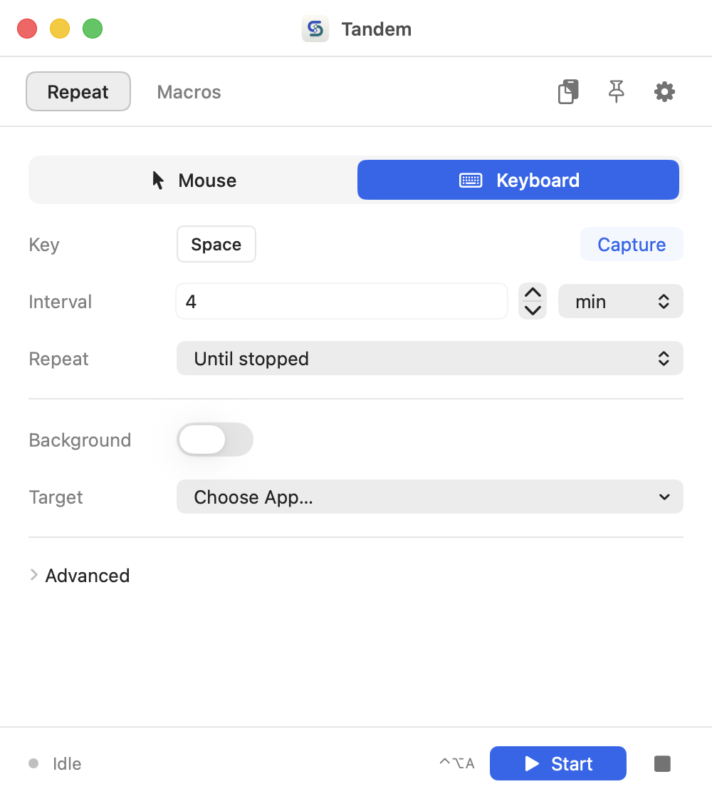

# Tandem

A small macOS app for repeated clicks, keyboard shortcuts, macros, and clipboard history.

<picture>
  <source media="(prefers-color-scheme: dark)" srcset="output/qa/tandem-dark.png">
  
</picture>

- **Repeat** a mouse click or captured key combination. Use the cursor, a fixed point, or several points, with an interval and a repeat count.
- **Record macros**, edit their steps, and save them for later. Replay once, a set number of times, or until stopped. Import and export macro files.
- **Find previous copies** of text, images, and files. Search, pin, copy again, or paste into the previous app. Set a copy limit or expiry to keep history short; pinned items stay.

Light, dark, and system themes, six accent colors, and an optional always-on-top panel are in Settings. The menu bar controls work while the main window is closed.

## Build and run

Requires macOS 14 or later and Xcode command line tools with Swift 5.10 or later.

```sh
git clone https://github.com/Luseefor/Automater.git
cd Automater
AutomaterMac/scripts/bundle_app.sh
AutomaterMac/scripts/install_local.sh
```

The installer puts Tandem in `/Applications` and opens it. Allow it in **System Settings → Privacy & Security → Accessibility** before recording or running automation.

Tandem was previously named Automater. Existing macros and settings are kept when upgrading.

## Click in one window while using another

1. In **Repeat → Mouse**, turn on **Background** and choose **Fixed point**.
2. Click **Pick…**, then select the spot in the target window. This also selects its app and window.
3. Set the interval and repeat count, then click **Start**.

The target follows its window when you move it. Your pointer stays free. Closing or minimizing the target stops playback.

For several points, choose **Multiple points → Pick Points…**, then **Finish**. **Burst ~100ms** clicks the whole list each round; **Sequential** waits between points. You can re-pick individual points without replacing the list.

### What background playback can do

Support depends on whether the target accepts macOS Accessibility actions or synthetic events. Some apps and games reject them. Background gameplay in Roblox is not verified.

Mouse-only macros can use Background playback. Macros containing keyboard input or text need **Foreground**. Playback across macOS Spaces is limited to supported Accessibility clicks and may need an initial visit to the target's Space.

Fast background bursts use an optional non-public CoreGraphics symbol. Timing varies by app; Accessibility delivery remains available when the symbol is missing. See [compatibility notes](docs/SUPPORT.md).

## Default shortcuts

These work while another app is active. Change them in Settings.

| Action | Shortcut |
| --- | --- |
| Start / stop repeat | ⌃⌥A |
| Start / stop recording | ⌃⌥R |
| Play / stop macro | ⌃⌥P |
| Stop all | ⌃⌥S |
| Grab a point | ⌃⌥G |
| Clipboard history | ⌃⌥V |

⌃ is Control; ⌥ is Option. While Tandem is active, **⌘.** also stops everything.

## Your data

Macros, settings, and clipboard history stay on your Mac. There are no accounts, analytics, or cloud sync. Clipboard history can be paused or cleared; it is not encrypted by Tandem. See the [privacy policy](docs/PRIVACY.md) for storage and cleanup details.

## Development

```sh
cd AutomaterMac
swift test
```

The bundle script produces `dist/Tandem.app` and `dist/Tandem.zip`. Run `zsh AutomaterMac/scripts/create_dmg.sh` from the repository root to make a DMG after bundling. Notarization requires a Developer ID signing identity and a `notarytool` keychain profile.

See the [QA notes](docs/QA.md) for automated coverage, native app checks, and known limits.

## License

[MIT](LICENSE)
